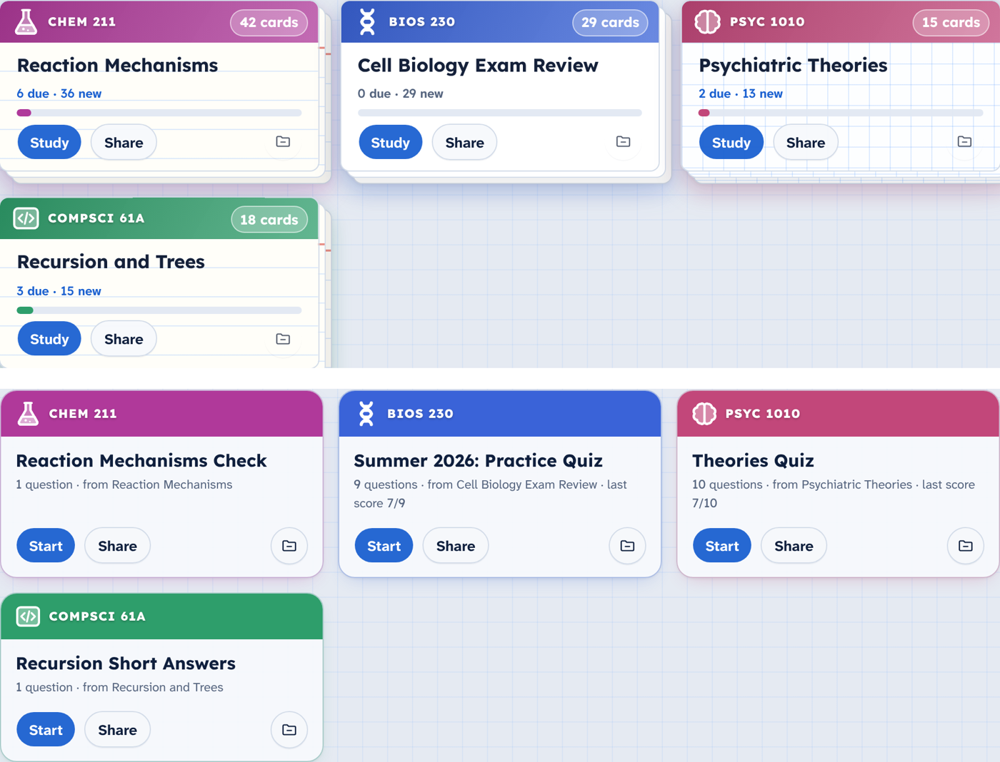

# Review tab cards: the old look

On 2026-11-19 the flashcard deck and quiz tiles on the Review tab were redesigned to match the concept map cards
(commit `657eae7`, "Review tab: deck and quiz cards in the concept map card style").



**Old decks:** each deck was one big flashcard in the deck's card style, with a coloured course band across the top
(course icon, course code, card count), the deck name, "due · new", the Prepared bar, and Study, Share and Archive along the bottom.

**Old quizzes:** a white card with a coloured course band, the quiz name, "questions · from · last score", and Start, Share and Archive.

## Switching back

The last version with the old tiles is commit `d63153b`. To undo only the redesign:

```bash
git revert 657eae7
node scripts/csp.js
```

The redesign touched `src/js/01-flashcards.js` (the tile markup in `viewFlashcards` and `viewQuizzes`), added
`src/css/99-rv-cards.css` (listed in `src/app.json`), and updated four tests: deck-reorder, uxcleanup, quiz-from-material and exam-mode.
The old styles were never deleted (`.deck-fc`, `.qz-card` in `src/css/00-base.css` and `src/css/100-phone.css`), so reverting restores the old look as it was.
